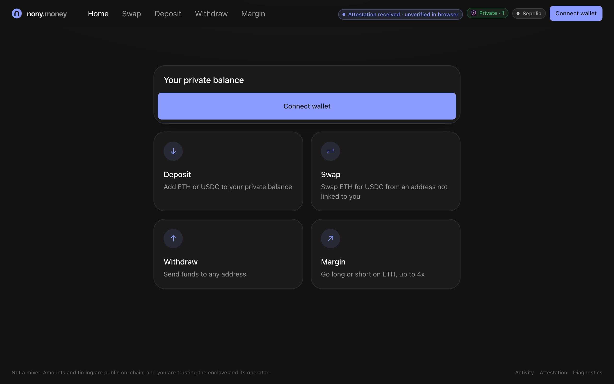
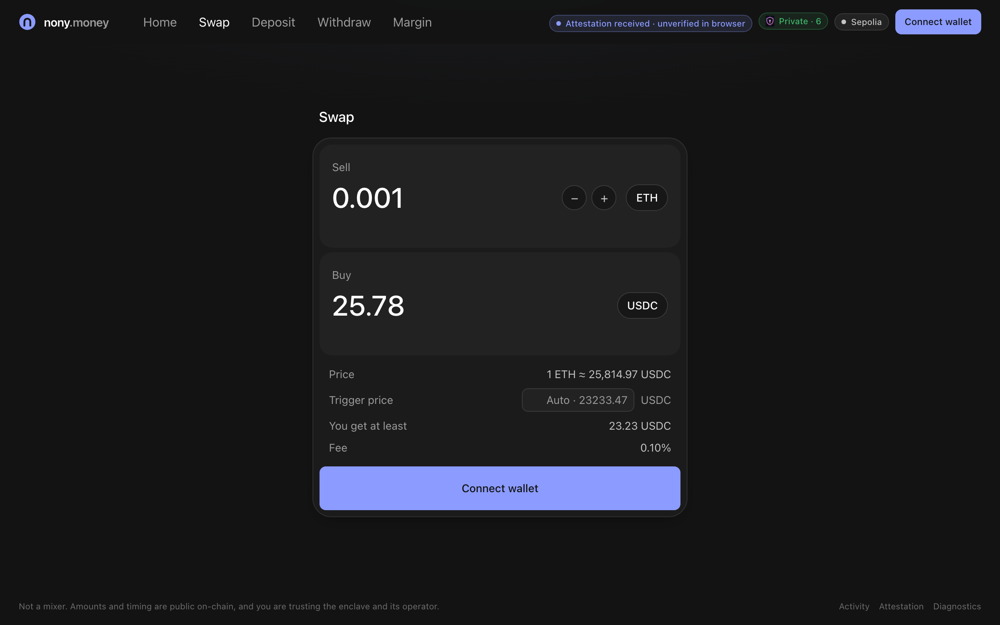
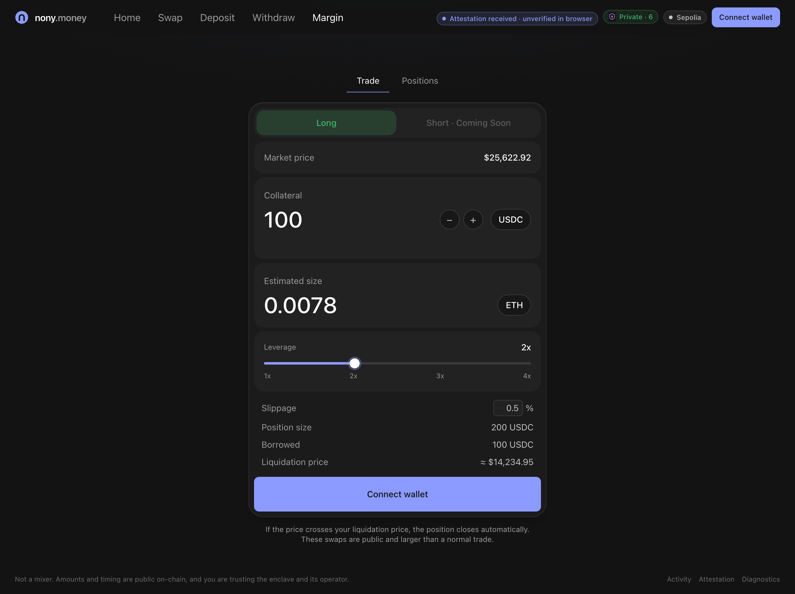
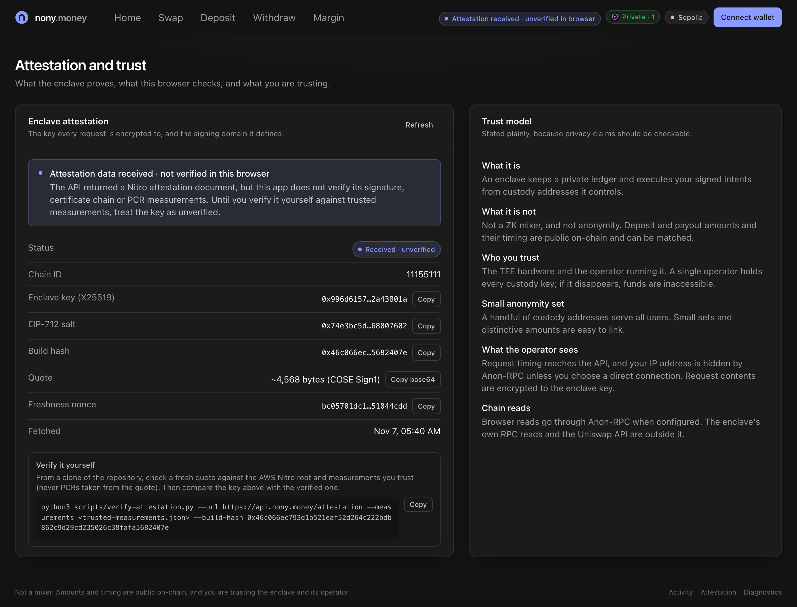
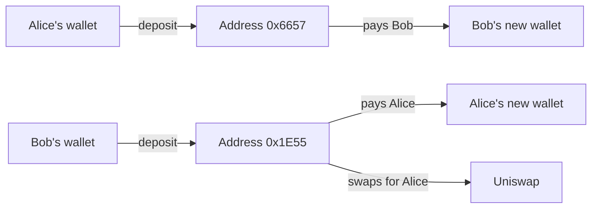
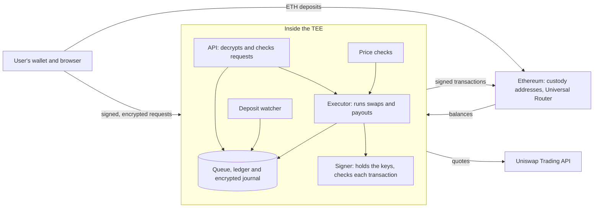

# Cloakroom

Swap and withdraw without tying your new wallet to the one you deposited from. Built at ETHGlobal Mumbai.

If you move ETH to a new wallet on Ethereum, the transfer itself connects the two, so anyone watching your old wallet can follow you. Privacy pools get around this with zero-knowledge proofs, but using one is visible on-chain.

Cloakroom does it differently. You deposit to an address we run, and your balance is a private entry in a ledger kept inside a trusted execution environment (TEE). When you swap or withdraw, the money leaves from a different address in the pool. On-chain it's just ordinary transfers and Uniswap swaps, with no privacy contract involved.

The catch is trust: you're trusting the TEE hardware and one operator, not math. It also isn't anonymity. Amounts and timing are still public, and with a few users that can give you away. [Known leaks](#known-leaks) has the full list.

## Screenshots

| Home | Swap |
| --- | --- |
|  |  |

| Margin | Attestation |
| --- | --- |
|  |  |

## A real example

We ran this on Sepolia through the real server and signer. It wasn't inside a TEE yet, so there's no confidentiality claim for this run.



Only the server knows which address and payout belong to whom. Here are the actual transactions.

Alice and Bob each deposit 0.02 ETH. A single test wallet paid for both here, which real users wouldn't do.

- [Alice's deposit](https://sepolia.etherscan.io/tx/0x5fb82751ee0ad88219e09ade2ff7d9a88c254ac993a66ef188248d7b91134837) goes to `0x6657...8Bc1`
- [Bob's deposit](https://sepolia.etherscan.io/tx/0xa126fc0aa6fe7d08cbeb87618e6cd571d2af294c12bddcb33bfd184f5960211a) goes to `0x1E55...0379`

Each withdraws 0.003 ETH to a fresh wallet, and each is paid from the other's deposit address.

- [Alice's payout](https://sepolia.etherscan.io/tx/0x241e8af3fcd9f65a7bf46f324f61e25d563142a52686dd0d6d530e90e91fea53) comes from `0x1E55...0379`
- [Bob's payout](https://sepolia.etherscan.io/tx/0x208756a4d82b0725312f411887f5f4f4b9f189e0d6e9b6b4e4f9c80bf24cf85c) comes from `0x6657...8Bc1`

Alice then signs an order to sell 0.001 ETH for USDC above a limit price. Her order stays inside the server. When a price check meets the limit, [the swap](https://sepolia.etherscan.io/tx/0x749e037765df655095b4205bfee238bb9c1a70585bc16371e6f4728dca829d9b) goes through Uniswap from `0x1E55...0379`. The ledger credits her 25.16 USDC. Nothing on-chain says it's hers.

## How it works



The service holds every custody key and the private ledger. Users sign requests with their own wallet and encrypt them to the service's key, which is proven by the TEE's attestation.

- Every balance change goes through one queue, so the same funds can't be spent twice.
- Every change is written to an encrypted, hash-chained journal before it takes effect. After a restart, the service replays the journal and works out what happened to anything in flight, without signing anything new.
- Uniswap's response isn't trusted. We decode the router calldata before signing and refuse anything we can't check, and the signer separately checks the journaled order. An order can't fill below its limit, even after our fee.
- Payouts and swaps never come from an address linked to that user.

The details are in [docs/enclave.md](docs/enclave.md) and [docs/chain-logic.md](docs/chain-logic.md).

## Status

Working on Sepolia, outside a TEE:

- Deposits, withdrawals and swaps through the API and the real signer
- Limit orders triggered by price checks

Working, tested on a local chain only:

- Recovery after a restart
- Rejecting replayed requests, changed destinations and double spends

Not done:

- Running the service inside Nitro. Attestation and custody are deployed there on their own, but not the full API
- The frontend isn't connected to the API
- Reconcile endpoint, CORS, rate limits and a pause switch
- Anon-RPC
- Withdrawing swapped USDC on Sepolia, which needs a seeded pool

Orders also expire after 5 minutes for now, because they share the expiry rule of every other signed request.

## Try it

You need Node 20+, pnpm and [Foundry](https://getfoundry.sh).

```bash
pnpm install
```

```bash
pnpm test
```

Some sealing tests only run on Linux and are skipped elsewhere.

`pnpm demo:local` runs the two-user story on a local chain, including the rejected attacks. It uses a mock Uniswap router and a stand-in signer, and says so when it runs.

To run the real service on Sepolia, set up `.env` from `.env.example`, start the service, and run the tests against it in a second terminal:

```bash
pnpm start:enclave
```

```bash
pnpm test:roundtrip
```

```bash
pnpm test:swap
```

[scripts/README.md](scripts/README.md) covers every command, and [.env.example](.env.example) lists the settings.

## Uniswap integration

Swaps go through the Trading API and Universal Router, from custody addresses not linked to the user. We deploy no contracts of our own. Our feedback on the API is in [FEEDBACK.md](FEEDBACK.md).

Contracts on Sepolia:

| Contract | Address |
| --- | --- |
| Universal Router 2.1.2 | [`0x7E4f6c5e954Da5c61B3423D81E2277431Ac043f3`](https://sepolia.etherscan.io/address/0x7E4f6c5e954Da5c61B3423D81E2277431Ac043f3) |
| WETH | [`0xfFf9976782d46CC05630D1f6eBAb18b2324d6B14`](https://sepolia.etherscan.io/address/0xfFf9976782d46CC05630D1f6eBAb18b2324d6B14) |
| USDC | [`0x1c7D4B196Cb0C7B01d743Fbc6116a902379C7238`](https://sepolia.etherscan.io/address/0x1c7D4B196Cb0C7B01d743Fbc6116a902379C7238) |

Where it is in the code:

| What | Code |
| --- | --- |
| Calling the Trading API | [`uniswap.ts:73`](services/enclave/src/uniswap.ts#L73) |
| Checking prices from quotes | [`price-poller.ts:86`](services/enclave/src/price-poller.ts#L86) |
| Running a swap | [`executor.ts:372`](services/enclave/src/executor.ts#L372) |
| Requesting a quote for a swap | [`executor.ts:427`](services/enclave/src/executor.ts#L427) |
| Checking the router calldata | [`executor.ts:467`](services/enclave/src/executor.ts#L467), [`swap-calldata.ts:72`](services/enclave/src/swap-calldata.ts#L72) |
| The signer's own check of the order | [`keys.ts:304`](services/enclave/src/keys.ts#L304) |
| Simulating the swap | [`executor.ts:485`](services/enclave/src/executor.ts#L485) |
| Sending the swap | [`executor.ts:548`](services/enclave/src/executor.ts#L548) |
| Reading the output from the receipt | [`executor.ts:585`](services/enclave/src/executor.ts#L585) |

## CROPS

- **Censorship resistant:** weak today. One operator runs the only node and holds the keys. If it goes away or refuses a user, their funds are stuck, and there's no key handover or escape path.
- **Open source:** MIT licensed, and the service runs from this repo.
- **Private:** the main point of the project. Who learns what is below.
- **Secure:** keys are generated inside the enclave and never leave it. Users keep their own wallet keys, but custody keys aren't on their device, because the enclave has to sign without them. Signed requests are checked for replay and tampering.

| Party | What it learns |
| --- | --- |
| The enclave | Everything, which is why attestation matters |
| The operator | Nothing about users, if the TEE holds |
| Anyone reading the chain | Deposits to custody addresses, swaps and payouts, with amounts and timing, but not who they belong to |
| Our RPC provider | Which addresses the enclave reads, and the transactions it sends |
| Uniswap | Each swap's amount and custody address, and price checks from throwaway addresses, but not who it's for |

## Trust assumptions

The operator, KMS policy administrator and TEE hardware are trusted. There is one node, with no key handover, threshold custody or slashing. Complete rollback of custody and journal storage requires an external trusted checkpoint. Journal loss still loses accounting state.

## Known leaks

- Deposit and payout amounts and timing are visible on-chain.
- The payout to your destination wallet is visible.
- Gas top-ups from one funder publicly link custody addresses.
- Custody addresses become public once funded.
- The enclave's own RPC reads are visible to its RPC provider. Anon-RPC, once added, only covers the browser.
- Uniswap sees each swap request and price check, and our API key identifies us. It never sees who the user is.
- The anonymity set is small: 4 to 6 addresses and a few demo users.

## Team

- Felix: TEE and custody
- Shreyas: API and accounting
- Apurva: on-chain and execution
- Pradnyesh: frontend and web3 integrations

## Licence

[MIT](LICENSE)
