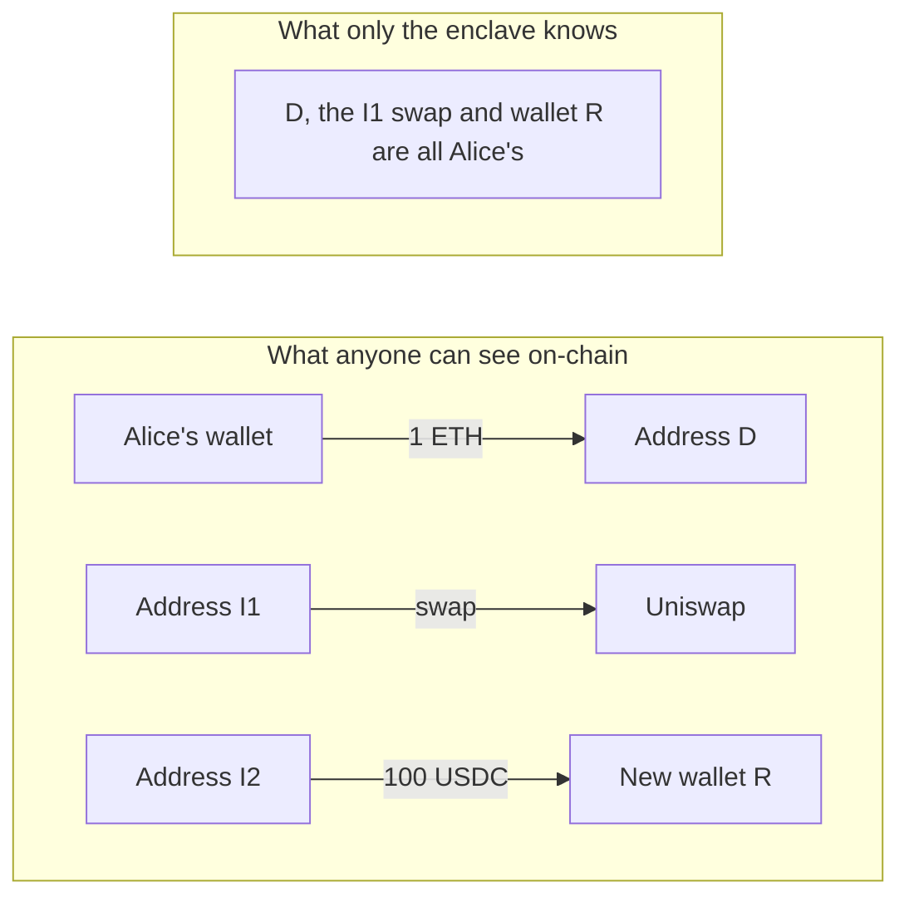
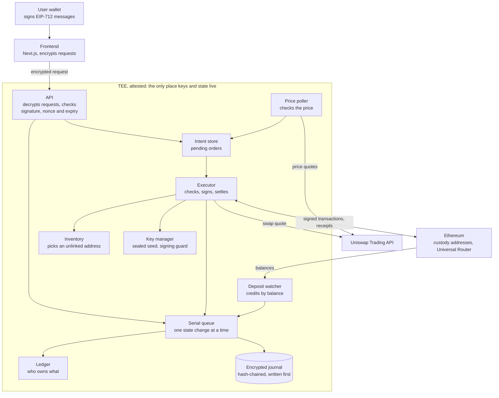
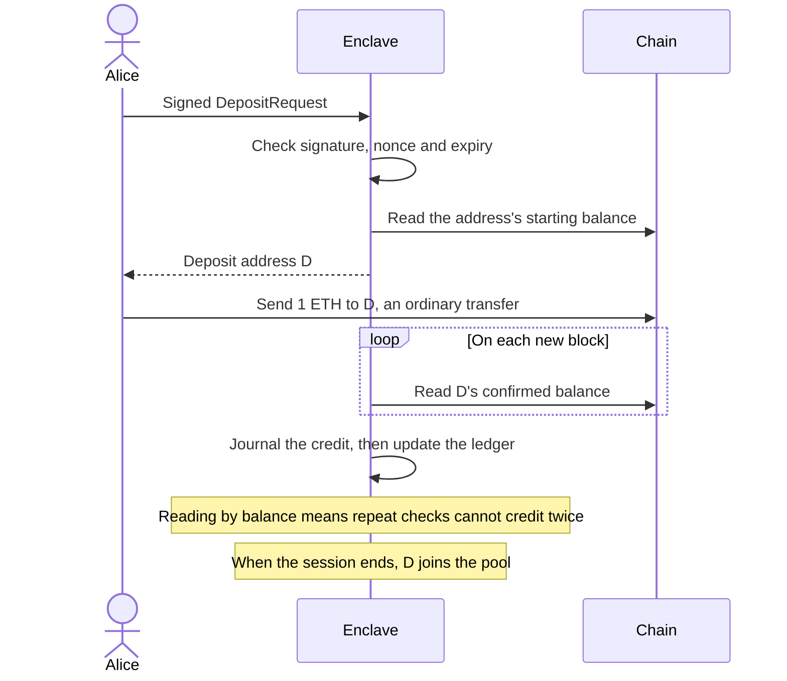
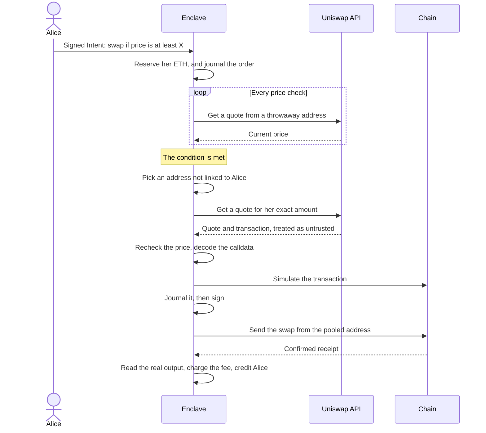
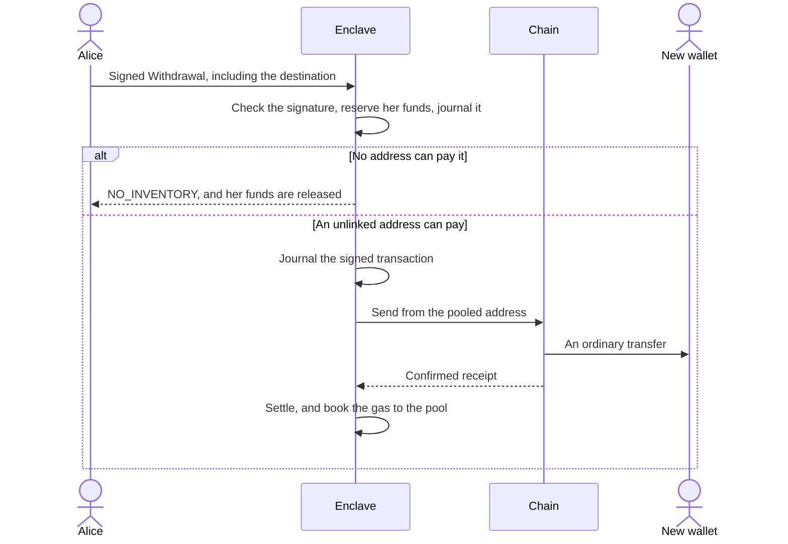
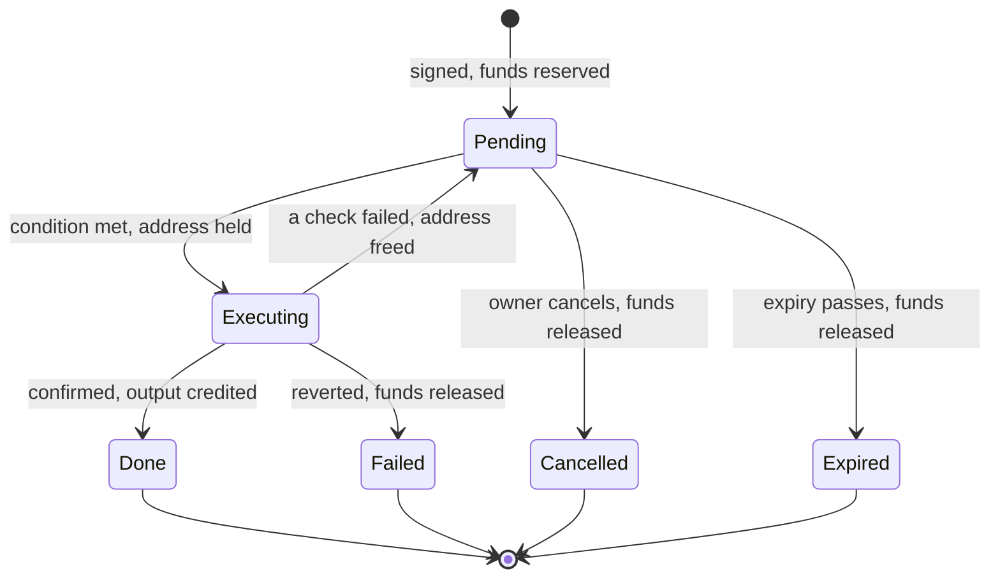
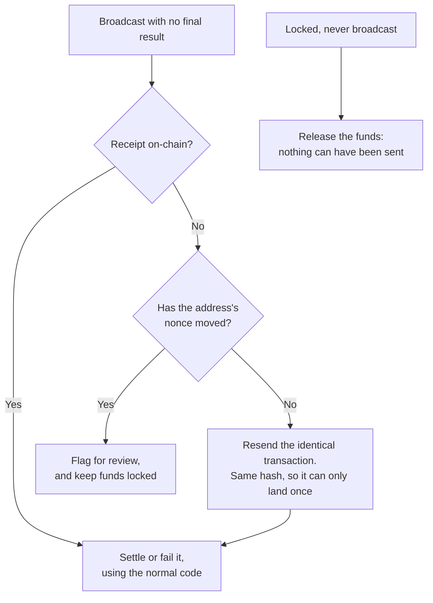

# Cloakroom

**Swap and withdraw without linking your new wallet to the one you deposited from.**

Cloakroom is a private intent network. You deposit ETH, hold a confidential balance, and sign an order such as "swap 0.1 ETH to USDC if the price reaches X". A trusted execution environment (TEE) runs the swap from a pooled address you never funded, then pays out to any wallet you choose. There is no mandatory privacy contract, so on-chain it looks like ordinary transfers and swaps.

> **What we claim:** private ownership coordination and intent execution, with no mandatory privacy-contract call.
>
> **What we don't claim:** that usage is undetectable, or anonymity. See [Known leaks](#known-leaks).

Built for ETHGlobal Mumbai.

## Why this exists

Every Ethereum wallet is public. Once someone links a wallet to you, they can see your balance, your trades and everywhere your money goes next. Moving funds to a new wallet doesn't help, because the transfer itself connects the two.

Privacy pools solve this with zero-knowledge proofs, but using one is visible on-chain. Cloakroom takes a different approach: **a trusted execution environment keeps the private record of who owns what**, and the chain only ever sees ordinary transfers and swaps.

The trade-off is trust. You rely on the TEE hardware and one operator, rather than on math alone. See [Trust assumptions](#trust-assumptions).

## How it works

Alice wants to swap ETH for USDC when the price is right, and end up with the USDC in a new wallet that nobody can connect to her.

1. **Deposit.** Alice sends ETH to an address the enclave assigns. The enclave credits her private balance.
2. **Order.** Alice signs a conditional swap with her existing wallet. The order and its trigger price stay inside the enclave.
3. **Swap.** When the price is met, the enclave swaps through Uniswap from a pooled address not linked to her.
4. **Withdraw.** Alice signs a withdrawal to a fresh wallet, and a different pooled address pays it.

Her balance is a claim on the pool, like a bank balance, not specific coins. So the money reaching her new wallet doesn't come from the address she funded.

### What's public, and what's private

Alice's deposit isn't what pays her. Her payout comes from other money in the pool.



No transaction connects those three on-chain rows. Amounts and timing can still give hints: see [Known leaks](#known-leaks).

## Architecture

Everything private lives inside one attested TEE. Everything outside it only sees signed requests, quote requests or ordinary transactions.



| Component | What it does | Code |
| --- | --- | --- |
| Key manager | Generates and seals the seed, derives custody addresses, and signs only approved operations | [`keys.ts`](services/enclave/src/keys.ts) |
| Auth | Verifies EIP-712 signatures, nonces and expiry | [`auth.ts`](services/enclave/src/auth.ts) |
| Serial queue | Runs one state change at a time, which stops double spends | [`queue.ts`](services/enclave/src/queue.ts) |
| Journal | Encrypted, hash-chained log, written before any change takes effect | [`journal.ts`](services/enclave/src/journal.ts) |
| Ledger | Available and reserved balances, rebuildable from the journal | [`ledger.ts`](services/enclave/src/ledger.ts) |
| Deposit watcher | Credits deposits from balance changes, after confirmations | [`watcher.ts`](services/enclave/src/watcher.ts) |
| Inventory | Tracks what each address holds, and picks one not linked to the user | [`inventory.ts`](services/enclave/src/inventory.ts) |
| Price poller | Gets a quote on a timer, and triggers orders | [`price-poller.ts`](services/enclave/src/price-poller.ts) |
| Executor | Runs swaps and withdrawals, and recovers after a restart | [`executor.ts`](services/enclave/src/executor.ts) |
| Calldata check | Proves a Uniswap transaction pays the right address enough | [`swap-calldata.ts`](services/enclave/src/swap-calldata.ts) |

**Design rule:** every on-chain operation follows one order: reserve funds, journal, sign, broadcast, confirm, settle. Nothing is signed before its journal entry exists, so a restart can always tell what happened.

These diagrams show the intended design. [Status](#status) shows what's built so far.

## The flows

### Deposit



### Conditional swap



### Withdrawal



### The life of an order

Reserved funds end up either spent on a confirmed swap or back in the owner's balance. The one exception is below: a transaction recovery can't explain stays locked for review.



### After a crash

If the enclave restarts mid-transaction, recovery reads the journal and the chain, and never signs anything new.



If the RPC can't answer, the operation is reported as unresolved and nothing changes.

## How funds stay safe

| What could go wrong | What stops it | Status |
| --- | --- | --- |
| Replaying a signed request | Each owner's nonce must increase | Built |
| Changing the destination after signing | The signature no longer matches | Built |
| Spending the same balance twice at once | One serialized queue, with funds reserved first | Built |
| One token covering another's shortfall | Balances are tracked per token | Built |
| Uniswap's transaction paying someone else | Router calldata is decoded before signing, and unknown commands are refused | Built |
| A bad price from Uniswap | Slippage limits, the condition rechecked on the swap's own quote, and simulation | Built |
| A crash mid-transaction running it twice | The journal is written before sending, and recovery resends only the identical transaction | Built |
| A tampered journal | Each entry carries the hash of the one before | Built |
| A fill below the order's limit | The minimum output can't go below amount times limit price, however much slippage is set | [Built in the executor, signer check to come](docs/decisions/2026-11-06-1555-binding-limit-floor.md) |
| A signer asked to sign something unexpected | Each operation must be registered first, and signs only once | Built, swaps not yet allowed |

## Status

This is a work in progress. The core works end to end from the command line, but the parts are not yet joined into one running service.

| Part | Status |
| --- | --- |
| Crediting deposits by balance | Working, run on Sepolia |
| Choosing unlinked addresses, and withdrawals | Working, run on Sepolia |
| Swaps through the Uniswap Trading API and router | Working, with [a real swap on Sepolia](https://sepolia.etherscan.io/tx/0x350ea3b0af02aeb7cb56c9bc7a00c2e8f210e0f7d9193734a6a6dd62e88ea557) |
| Checking Uniswap's calldata before signing | Working, tested on real responses |
| Recovery after a restart | Working, tested on a local chain |
| Signed requests, replay protection, ledger, encrypted journal | Working, tested |
| Attestation and custody signer | Deployed Nitro service serves attestation and runs an unfunded self-test |
| Signer allowing swaps | Not built. Swap runs so far use a stand-in signer |
| Intent store, and pipeline from price checks to swaps | Working. The pipeline's own tests use a stand-in executor |
| Server and boot lifecycle | Working in simulation mode, tested on a local chain. Not yet deployed to Nitro |
| API routes | Attestation, operator seeding, session, deposit, balance and intent routes work. Withdrawal and reconcile routes are not built. Orders fail at signing until the signer allows swaps |
| Frontend | In progress, not yet connected |
| Anon-RPC | Not built |
| Live KMS provisioning, public HTTPS | Not done |

## Try it

You need Node 20+, pnpm and [Foundry](https://getfoundry.sh).

```bash
pnpm install
```

Run the whole demo on a local chain. Two users deposit, one swaps and withdraws to a new wallet, and replay, wrong-destination and double-spend attacks are rejected.

```bash
pnpm demo:local
```

It uses a mock Uniswap router, a stand-in signer and intent store, and no TEE, and it says so when it runs.

Run the tests:

```bash
pnpm test
```

Three tests in `kms-sealing.test.ts` and `sealed-state.test.ts` currently fail on macOS.

To run against real Sepolia, or to see every command, read [scripts/README.md](scripts/README.md). Settings are described in [docs/deployment.md](docs/deployment.md).

## Repo layout

| Path | What | Owner |
| --- | --- | --- |
| `services/enclave/` | The TEE service, and its scripts and tests | Felix, Shreyas, Apurva |
| `packages/shared/` | Types, EIP-712 definitions, schemas | Shreyas |
| `frontend/` | Next.js app | Pradnyesh |
| `infra/nitro/` | AWS Nitro deployment | Felix |
| `scripts/` | Attestation verification, and script docs | Felix, Apurva |
| `docs/` | Plans, decisions and role briefs | Everyone |
| `FEEDBACK.md` | Uniswap developer feedback | Apurva |

## Team

| Person | Workstream | Brief |
| --- | --- | --- |
| Felix | TEE and custody | [docs/roles/felix-tee.md](docs/roles/felix-tee.md) |
| Shreyas | API and accounting | [docs/roles/shreyas-api.md](docs/roles/shreyas-api.md) |
| Apurva | On-chain and execution | [docs/roles/apurva-onchain.md](docs/roles/apurva-onchain.md) |
| Pradnyesh | Frontend and web3 integrations | [docs/roles/pradnyesh-frontend.md](docs/roles/pradnyesh-frontend.md) |

Start with [docs/README.md](docs/README.md). Decisions and open questions are in [docs/decisions/](docs/decisions/README.md).

## Uniswap integration

Swaps run through the Uniswap Trading API and Universal Router, from custody addresses not linked to the user. Feedback is in [FEEDBACK.md](FEEDBACK.md).

**Proof it works:** a real swap on Sepolia, 0.001 ETH to 26.172175 USDC ([transaction](https://sepolia.etherscan.io/tx/0x350ea3b0af02aeb7cb56c9bc7a00c2e8f210e0f7d9193734a6a6dd62e88ea557)). It used a stand-in signer and journal, because the enclave's signing guard does not allow swaps yet.

### Contracts used (Sepolia)

We deploy no contracts of our own.

| Contract | Address |
| --- | --- |
| Universal Router 2.1.2 | [`0x7E4f6c5e954Da5c61B3423D81E2277431Ac043f3`](https://sepolia.etherscan.io/address/0x7E4f6c5e954Da5c61B3423D81E2277431Ac043f3) |
| WETH | [`0xfFf9976782d46CC05630D1f6eBAb18b2324d6B14`](https://sepolia.etherscan.io/address/0xfFf9976782d46CC05630D1f6eBAb18b2324d6B14) |
| USDC, the output token | [`0x1c7D4B196Cb0C7B01d743Fbc6116a902379C7238`](https://sepolia.etherscan.io/address/0x1c7D4B196Cb0C7B01d743Fbc6116a902379C7238) |

### Where the integration is

| What | Code |
| --- | --- |
| Calling the Trading API | [`uniswap.ts:73`](services/enclave/src/uniswap.ts#L73) |
| Checking prices from quotes | [`price-poller.ts:86`](services/enclave/src/price-poller.ts#L86) |
| Running a swap | [`executor.ts:370`](services/enclave/src/executor.ts#L370) |
| Requesting a quote for a swap | [`executor.ts:425`](services/enclave/src/executor.ts#L425) |
| Checking the router calldata before signing | [`executor.ts:465`](services/enclave/src/executor.ts#L465), [`swap-calldata.ts:71`](services/enclave/src/swap-calldata.ts#L71) |
| Simulating the swap | [`executor.ts:483`](services/enclave/src/executor.ts#L483) |
| Sending the swap | [`executor.ts:545`](services/enclave/src/executor.ts#L545) |
| Reading the output from the receipt | [`executor.ts:582`](services/enclave/src/executor.ts#L582) |
| Tests, including real Sepolia responses | [`executor-intent.test.ts`](services/enclave/test/executor-intent.test.ts), [`swap-calldata.test.ts`](services/enclave/test/swap-calldata.test.ts) |

### Check it yourself

Needs Foundry, and `.env` set up as in [scripts/README.md](scripts/README.md) for the last two commands.

```bash
pnpm test
```

```bash
pnpm smoke:quote
```

```bash
pnpm smoke:swap
```

## CROPS

- **Censorship resistant:** weak today. One operator runs the only node and holds the keys. If it goes away or refuses a user, their funds are stuck. There is no key handover or escape path in this version.
- **Open source:** MIT licensed. `pnpm demo:local` runs from this repo alone. Running the full service is not yet possible, because it is not yet joined together.
- **Private:** the lead property. See below for what each party learns.
- **Secure:** keys are generated inside the enclave and never leave it. Users keep their own wallet keys, but custody keys are not on the user's device, because the enclave must sign without them. Every signed request is checked for replay and tampering, and Uniswap's calldata is checked before signing. Trust assumptions are below.

| Party | What it learns |
| --- | --- |
| The enclave | Everything. This is why attestation matters |
| The operator | Nothing about users, if the TEE holds. The enclave's public addresses, like anyone |
| Anyone reading the chain | Deposits to custody addresses, swaps and payouts, with amounts and timing. Not who they belong to |
| Our RPC provider | Which addresses the enclave reads, and the transactions it sends |
| Uniswap | Each swap's amount and custody address, plus price polls from throwaway addresses. Not who it is for |
| Analytics or trackers | Nothing. The client should include none |

## Trust assumptions

The operator, KMS policy administrator and TEE hardware are trusted. There is one node, with no key handover, threshold custody or slashing. External encrypted state is implemented; live KMS recovery remains unverified. Complete rollback of custody and journal storage requires an external trusted checkpoint. Journal loss still loses accounting state.

## Known leaks

- Deposit and payout amounts and timing are visible on-chain.
- The payout edge to the destination wallet is visible.
- Gas top-ups from one funder publicly link custody EOAs.
- Custody EOA addresses become public once funded.
- The enclave's own RPC reads are visible to its RPC provider. Anon-RPC, once added, covers the browser only.
- Uniswap's Trading API sees each swap request and price poll, and our API key identifies us. It never sees who the user is.
- The anonymity set is small, with 4 to 6 EOAs and a few demo users.

## Licence

[MIT](LICENSE)
