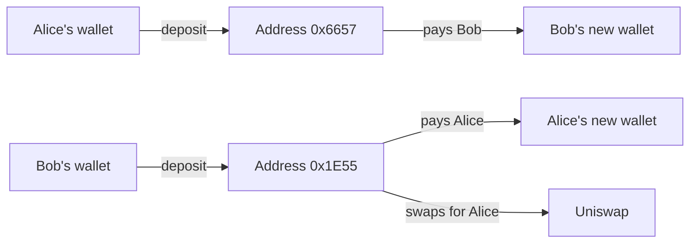
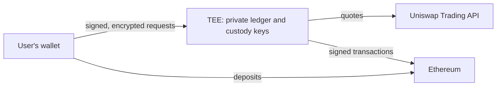

# nony.money

**Don't get blacklisted.**

Using Tornado Cash or other privacy-preserving smart contracts is visible on-chain, which can get your funds flagged or blacklisted.

nony.money doesn't use privacy smart contracts. You deposit funds into an address secured by a TEE and join the nony pool. Within the pool, you can privately trade, swap, borrow, lend, or withdraw. Your funds leave from a different address.

On-chain, they look like regular transfers.

## Screenshots

| Home | Swap |
| --- | --- |
|  |  |

| Margin | Attestation |
| --- | --- |
|  |  |

## A real Example




Only the server (aws nitro) knows which address and payout belong to whom.

Alice and Bob each deposit 0.02 ETH. A single test wallet paid for both here, which real users wouldn't do.

- [Alice's deposit](https://sepolia.etherscan.io/tx/0x5fb82751ee0ad88219e09ade2ff7d9a88c254ac993a66ef188248d7b91134837) goes to `0x6657...8Bc1`
- [Bob's deposit](https://sepolia.etherscan.io/tx/0xa126fc0aa6fe7d08cbeb87618e6cd571d2af294c12bddcb33bfd184f5960211a) goes to `0x1E55...0379`

Each withdraws 0.003 ETH to a fresh wallet, and each is paid from the other's deposit address.

- [Alice's payout](https://sepolia.etherscan.io/tx/0x241e8af3fcd9f65a7bf46f324f61e25d563142a52686dd0d6d530e90e91fea53) comes from `0x1E55...0379`
- [Bob's payout](https://sepolia.etherscan.io/tx/0x208756a4d82b0725312f411887f5f4f4b9f189e0d6e9b6b4e4f9c80bf24cf85c) comes from `0x6657...8Bc1`

Alice then signs an order to sell 0.001 ETH for USDC above a limit price. Her order stays inside the server. When a price check meets the limit, [the swap](https://sepolia.etherscan.io/tx/0x749e037765df655095b4205bfee238bb9c1a70585bc16371e6f4728dca829d9b) goes through Uniswap from `0x1E55...0379`. The ledger credits her 25.16 USDC. Nothing on-chain says it's hers.

## How it works



The TEE holds all private keys and tracks balances. Users sign requests with their wallets and encrypt them using the TEE's verified public key.

## Try it

You need Node 20+, pnpm and [Foundry](https://getfoundry.sh).

```bash
pnpm install
```

```bash
pnpm test
```


```bash
pnpm start:enclave
```

```bash
pnpm test:roundtrip
```

```bash
pnpm test:swap
```

## Uniswap integration

Swaps go through the Trading API and Universal Router, from custody addresses not linked to the user. We deploy no contracts of our own. 


Where it is in the code:

| What | Code |
| --- | --- |
| Calling the Trading API | [`uniswap.ts:73`](services/enclave/src/uniswap.ts#L73) |
| Checking prices from quotes | [`price-poller.ts:86`](services/enclave/src/price-poller.ts#L86) |
| Running a swap | [`executor.ts:372`](services/enclave/src/executor.ts#L372) |
| Requesting a quote for a swap | [`executor.ts:427`](services/enclave/src/executor.ts#L427) |
| Checking the router calldata | [`executor.ts:467`](services/enclave/src/executor.ts#L467), [`swap-calldata.ts:72`](services/enclave/src/swap-calldata.ts#L72) |
| The signer's own check of the order | [`keys.ts:304`](services/enclave/src/keys.ts#L304) |
| Simulating the swap | [`executor.ts:485`](services/enclave/src/executor.ts#L485) |
| Sending the swap | [`executor.ts:548`](services/enclave/src/executor.ts#L548) |
| Reading the output from the receipt | [`executor.ts:585`](services/enclave/src/executor.ts#L585) |


## Trust assumptions

The operator, KMS policy administrator and TEE hardware are trusted. There is one node.


## Licence

[MIT](LICENSE)
