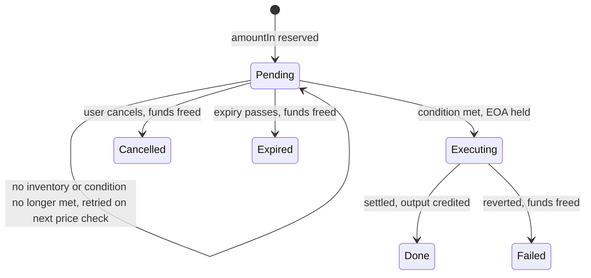

# Chain logic

Every on-chain operation follows one order: **reserve funds, journal, sign, broadcast, confirm, settle.** Nothing is signed before its journal entry exists.

## Intent lifecycle



Only a confirmed swap consumes the reserved funds. Every other ending gives them back to the owner's available balance.

## Deposits (`watcher.ts`)

Allow ETH deposits, or USDC deposits together with ETH for gas at the same address. Accept USDC only after both deposits are confirmed. The USDC path is pending implementation; the current ETH flow is:

1. The user signs a DepositRequest. The enclave verifies the signature and nonce, assigns a fresh unused EOA exclusively to this session, and returns its address and expiry.
2. The user sends ETH to that address with an ordinary transfer.
3. When a session opens, record the assigned EOA's native balance as its baseline.
4. On each new block, read that balance at `head - CONFIRMATIONS`. Credit the owner with the increase over what is already credited. Journal `DEPOSIT_CREDITED` first, then call `ledger.credit`.
5. Crediting by the recipient's balance, not by the sender, also works for smart-contract wallets. The sender is recorded but not required.
6. After expiry and one last check, close the session and relabel the EOA as inventory. Later transfers to a closed address are not credited and need a manual refund, which is out of scope.

## Inventory selection (`inventory.ts`)

```ts
function pick(token: Address, amt: bigint, exclude: Set<Address>): CustodyEOA | null {
  const need = token === NATIVE ? amt + GAS_RESERVE_WEI : amt;
  return eoas
    .filter(e => e.role === 'inventory' && !e.inFlight && !exclude.has(e.address))
    .filter(e => freeBalance(e, token) >= need)              // physical balance minus holds
    .sort((a, b) => a.lastUsedAt - b.lastUsedAt)             // least recently used first
    [0] ?? null;
}
```

`exclude` holds the EOAs that received this owner's deposits and ran this owner's earlier swaps. This is what separates the funded address from the executing address. With 4 to 6 EOAs the choice is small, so say that in the demo.

## Swap execution (`executor.ts`)

The enclave checks the price every `PRICE_POLL_INTERVAL_SEC` from its own Uniswap quote, and evaluates pending intents against it. When a condition is met, `Executor.runIntent`:

1. Refreshes inventory, picks an EOA not linked to the owner, and calls `inventory.hold`.
2. Gets a quote for exactly `amountIn` from the Trading API, limited to V2 and V3 routes, with the chosen EOA as `swapper`. Sets `minOut = quote.out * (1 - slippageBps / 10000)`, where the owner's slippage is capped by `MAX_SLIPPAGE_BPS_CAP`.
3. Rechecks the intent's condition using this quote's implied price, because a larger amount can get a worse price than the poll did.
4. Treats the API's transaction as untrusted. Requires `to === UNIVERSAL_ROUTER_ADDRESS`, `from` to be the EOA and `value` to equal `amountIn`, then decodes the router commands to prove the EOA receives at least `minOut`. See [Swap safety rules](decisions/2026-11-06-1304-swap-safety-rules.md).
5. Runs the transaction through `eth_call`.
6. Registers it with the signing guard, signs, computes the hash from the serialized transaction, journals `EXEC_BROADCAST`, then sends the raw transaction.
7. After `CONFIRMATIONS` blocks, sums the output token's Transfer logs to the EOA in the receipt. That sum is `amountOut`.
8. Journals `EXEC_SETTLED` and `FEE_BOOKED` and applies them to the ledger, which consumes the reserved input, credits the output minus `FEE_BPS`, and books the gas. Then refreshes inventory and frees the hold.

A problem before step 6 leaves the intent pending, with nothing sent. If the signer refuses, the intent fails and the funds are released. If the receipt shows a revert, `EXEC_FAILED` releases the funds, and the gas spent is the pool's cost. If the result is unknown, the funds stay reserved and the EOA stays busy until recovery settles it.

**Token handling:** v1 only swaps ETH to the configured output token. The router wraps the ETH itself, and no approval is needed. An ERC-20 input would need a Permit2 signature.

## Withdrawal

1. `ledger.reserve`, journal `WITHDRAWAL_LOCKED`, then `inventory.pick` with the owner's EOAs excluded.
2. Build a native send, or `transfer(to, amount)` on the token contract. The destination is the signed `to`.
3. Sign, journal `WITHDRAWAL_BROADCAST`, send, wait for confirmations, then `ledger.consume` and journal `WITHDRAWAL_CONFIRMED`.
4. If `pick` returns nothing, release the lock and return `NO_INVENTORY`. There is no consolidation step in the MVP.

**After a broadcast, only a confirmed revert releases the funds.** If the result is unknown, for example when the receipt times out, the transaction may still land, so the funds stay reserved and the EOA stays busy until recovery settles it.

## Gas

Every inventory EOA keeps `GAS_RESERVE_WEI`, which reconcile excludes from claims. Top-ups from one funder link the EOAs publicly. List that as a known leak.

## Inventory funding

Inventory comes from user deposits and swaps; USDC deposits must include ETH for gas. Operator seeding is optional for demo fixtures and must be disclosed when used.

## Recovery on boot (`executor.recover`)

Runs once on boot, after replay and before anything else starts. Unfinished operations get their holds back before any network call. For each broadcast without a final event:

- **Receipt found:** settle or fail it, through the same code as a normal run.
- **No receipt, and the EOA nonce has not moved:** send the identical raw transaction again, then settle.
- **No receipt, and the nonce moved:** flag it for review, and keep the funds reserved.
- **The chain cannot be reached:** leave it unresolved, and try again on the next boot.

A withdrawal locked but never broadcast has its funds released, because the broadcast is journaled before sending. This is why the raw signed transaction is stored in the BROADCAST journal events. See [Recovery rules](decisions/2026-11-06-1330-recovery-rules.md).

## Known gaps

- A stuck transaction is not fee-bumped in the MVP.
- A reorg deeper than `CONFIRMATIONS` after settlement is not handled.
