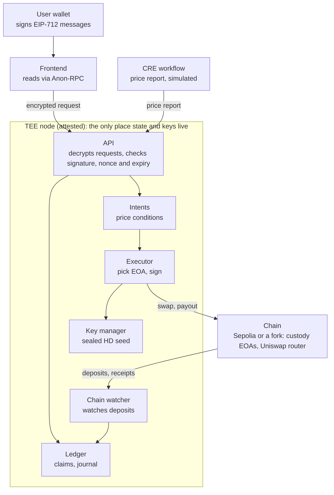

# Overview

## Goal

Build one complete flow on one EVM network: deposit ETH, get a confidential balance, submit a conditional swap, have it executed from pooled inventory, and withdraw tokens to an existing wallet. One real TEE node holds every key.

### In scope

- One attested TEE node that generates all EOA keys internally
- One asset pair and one router (Uniswap)
- Fungible claims against pooled inventory, not per-user accounts
- Deposit and withdrawal by ordinary transfer, using the user's existing wallet
- One conditional intent type: swap when a price condition is met
- A frontend for deposit, balance, intent status and withdrawal

### Out of scope (say so in the demo)

- Key handover, multi-node or threshold custody, slashing
- General DeFi execution, ZK proofs, anonymity guarantees

### Claim to make

Private ownership coordination and intent execution with no mandatory privacy-contract call. Never claim that usage is undetectable.

### Definition of done

A judge can watch two users deposit, one swap run from an EOA that neither user funded, and a payout land in a normal wallet. Replayed requests, unauthorized destinations and concurrent overspends must be rejected live.

## Architecture

Everything outside the TEE node (the wallet, the frontend, the CRE workflow and the chain) only sees signed requests, price reports or ordinary transactions.

| Module | Responsibility | Owner |
| --- | --- | --- |
| API | Decrypt requests, verify signature, nonce and expiry, hand off to the ledger | Shreyas (decryption: Felix) |
| Ledger | Balances, reservations, journal, reconcile check | Shreyas |
| Intents | Store intents and evaluate price conditions on each report | Shreyas |
| Executor | Choose an inventory EOA, build the swap or transfer, sign, broadcast, settle | Apurva |
| Key manager | Generate and seal the HD seed, derive EOAs, sign only for approved operations | Felix |
| Chain watcher | Track deposits, confirmations and receipts | Apurva |

## Stack

TypeScript end to end, with Foundry for chain tooling. Items marked *verify* depend on provider docs nobody has checked yet.

| Layer | Choice | Notes |
| --- | --- | --- |
| TEE runtime | Pick one in the first 3 hours: EigenCompute (EigenCloud), Phala dstack (Intel TDX), or AWS Nitro Enclaves | *Verify* current access, pricing and attestation format. Fallback: same container, clearly labelled TEE-simulated |
| Enclave service | TypeScript, Node 20+, Fastify, zod, viem | One process. All ledger writes go through a single serialized queue |
| Key management | Seed generated inside the enclave, EOAs derived by HD path, seed sealed to the enclave | No key export endpoint. Never log keys or custody EOA addresses |
| Ledger storage | In-memory state plus an append-only, hash-chained journal, encrypted before it touches disk | PostgreSQL only for non-secret metadata, if at all |
| Chain | Sepolia, or an Anvil mainnet fork if Uniswap liquidity is missing there | Decide in phase 0 |
| DEX | Uniswap: Trading API for quotes, Universal Router or SwapRouter for execution | One pair, for example WETH to a test USDC. Confirm a pool with liquidity on the chosen network |
| Client signing | EIP-712 through wagmi and viem, signed by the user's existing wallet | No custom wallet. Auth key is separate from custody keys |
| Frontend | Next.js, wagmi, RainbowKit, TanStack Query, Tailwind, Anon-RPC browser harness for chain reads | No third-party analytics |
| Trigger | Chainlink CRE workflow, run through the CRE CLI simulation | *Verify* CLI setup and access early |
| Packaging | Docker image, pinned dependencies, reproducible build | Judges and attestation both want a build they can rebuild |
| Tests | Foundry and Anvil for chain, Vitest for ledger and API, fast-check for property tests | Reconcile runs after every test |

Tooling: pnpm workspaces and TypeScript strict mode.

## Arrange before hour 0

- TEE provider account and a deploy that returns an attestation quote (Felix)
- RPC provider key and testnet ETH for 4 to 6 custody EOAs (Apurva)
- Uniswap developer platform key (Apurva)
- WalletConnect project ID (Pradnyesh)
- Test token liquidity, or a funded fork (Apurva)
